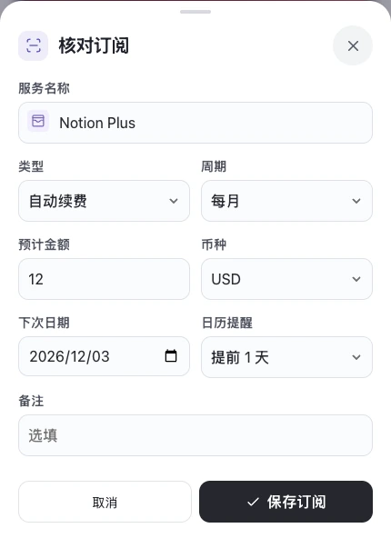
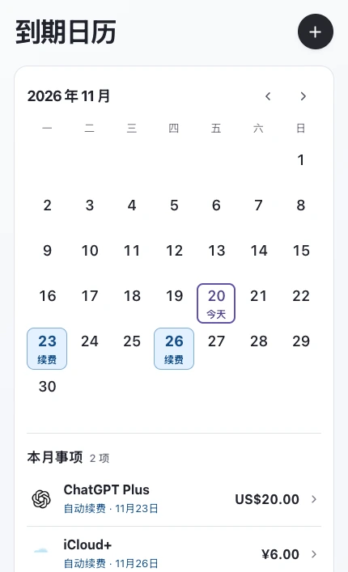

# 知期 DueCue · 订阅管理与续费提醒

**知期 DueCue** 是适合 iPhone、iPad 和浏览器的个人订阅管理工具。把 ChatGPT、视频会员、云存储和手机套餐放进同一个订阅卡包，随时查看下次扣款日期和未来几天的预计续费。

[打开知期官网](https://duecue.jane-zz.online/) · [查看 iPhone 安装指引](https://duecue.jane-zz.online/welcome#install)

## 知期能做什么

| 功能 | 使用场景 |
| --- | --- |
| **订阅卡包** | 集中记录金额、币种和续费周期，区分即将续费、已扣款和会员到期事项。 |
| **账单截图导入** | 上传账单截图，AI 解析服务名称、金额和日期，核对后保存。也可以手动添加。 |
| **到期日历** | 按月查看各项续费，或从订阅详情导出日程到 iPhone 日历。 |
| **近期续费汇总** | 选择统计天数，用人民币或美元估算期间的自动续费总额。 |

## 手机界面

| 截图导入后的核对页 | 订阅到期日历 |
| --- | --- |
|  |  |

## 怎么安装和开始使用

1. 用 iPhone 或 iPad 的 Safari 打开 [知期官网](https://duecue.jane-zz.online/)。
2. 在 Safari 菜单里点击「分享」→「添加到主屏幕」，然后打开桌面上的「知期」。
3. 使用邮箱登录或注册，进入卡包后用「截图」或「手动」添加第一笔订阅。用电脑时可以直接在浏览器里使用。

## 常见问题

### 怎样让 iPhone 提醒我续费？

在知期打开订阅详情，点击「加入日历」，再将生成的日程导入 iPhone 日历。系统日历负责提醒。如果你在知期改了续费日期，可以重新导入，再在系统日历中移除旧日程。

### 美元和人民币的订阅能汇总在一起吗？

可以。点卡包下方的「预计续费」，选择统计天数和汇总币种。遇到不同币种的订阅时，知期按近期可用的汇率折算，并显示所用汇率的日期。

### 试用从什么时候开始？

首次保存个人订阅或完成一次 AI 解析后，开始 7 天试用。试用结束后仍可查看已有记录。

## 开发与部署

建议使用 Node.js 24。本地预览使用 Vinext 和 Cloudflare D1，VPS 部署使用 Docker Compose 和 SQLite。

- [本地开发、数据库初始化与 VPS 构建](docs/development.md)
- [支付宝网页支付接入](docs/alipay/README.md)
- [开发历史说明](HISTORY.md)
