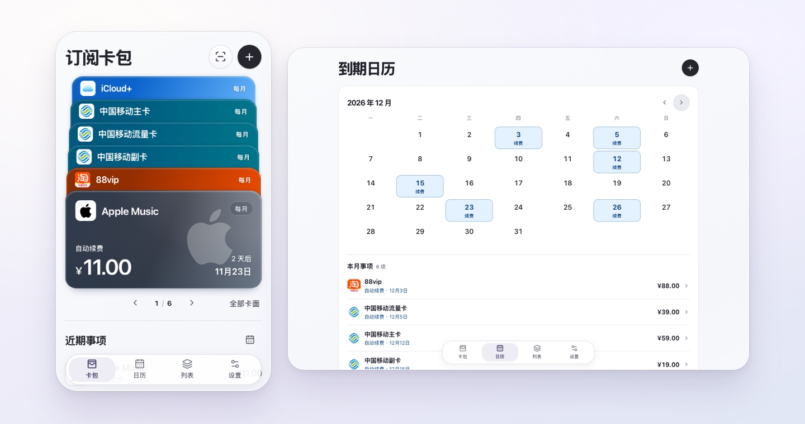

<h1 align="center">知期 DueCue</h1>

<strong>个人订阅管理与续费提醒 · Subscription Tracker</strong>

把 ChatGPT、视频会员和手机套餐放进同一个卡包，看看哪天扣款、接下来要花多少。

账单截图导入 · iPhone 日历提醒 · 多币种续费汇总 · PWA

  <a href="https://duecue.jane-zz.online/"><strong>立即体验</strong></a> ·
  <a href="https://duecue.jane-zz.online/welcome#install">安装到主屏幕</a> ·
  <a href="docs/development.md">开发文档</a>

  

## 开始使用

1. 用 iPhone 或 iPad 的 Safari 打开 [知期官网](https://duecue.jane-zz.online/)。
2. 在 Safari 菜单里点击「分享」→「添加到主屏幕」，然后打开桌面上的「知期」。
3. 完成邮箱注册即开始 30 天免费试用。进入卡包后，用「截图」或「手动」添加第一笔订阅。

知期也可以直接在电脑浏览器中使用。

## 主要功能

- **订阅卡包**集中记录金额、币种和周期，区分已扣款和即将续费的事项。
- **账单截图导入**通过 AI 解析服务名称、金额和日期，核对后保存。
- **到期日历**按月查看扣款安排，也能将单项续费导入系统日历。
- **近期续费汇总**按自选天数计算即将扣款的金额，可汇总为人民币或美元。

## 常见问题

### 怎样让 iPhone 提醒我续费？

在知期打开订阅详情，点击「加入日历」，再将生成的日程导入 iPhone 日历。系统日历负责提醒。如果你在知期改了续费日期，可以重新导入，再在系统日历中移除旧日程。

### 美元和人民币的订阅能汇总在一起吗？

可以。点卡包下方的「预计续费」设置汇总币种。知期按近期可用的汇率折算，并显示所用汇率的日期。

### 怎样申请永久使用？

在「设置 → 账号与权益」里点「申请永久使用」，发邮件给作者申请兑换码。收到后，在同一栏打开「使用兑换码」兑换。试用结束后仍可查看已有记录。[发邮件申请](mailto:2689124001@qq.com)

## 开发与部署

建议使用 Node.js 24。本地预览使用 Vinext 和 Cloudflare D1，VPS 部署使用 Docker Compose 和 SQLite。

- [本地开发、数据库初始化与 VPS 构建](docs/development.md)
- [开发历史说明](HISTORY.md)
