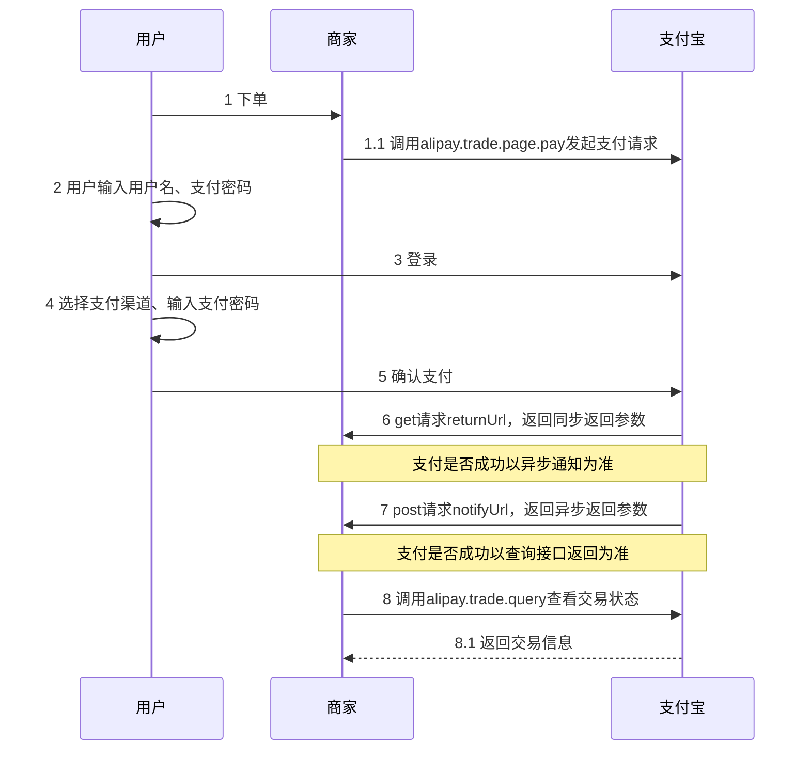
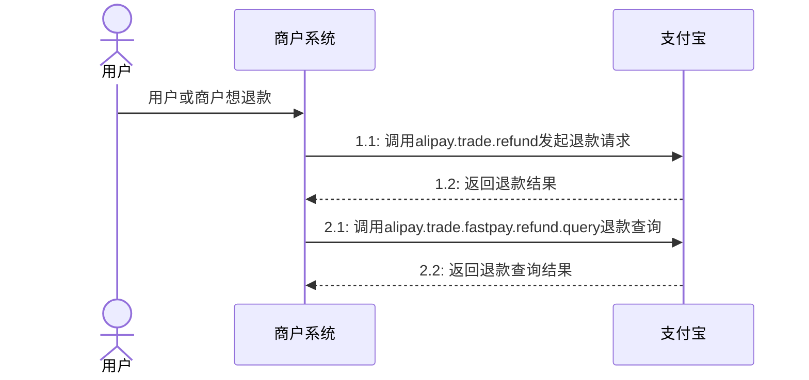
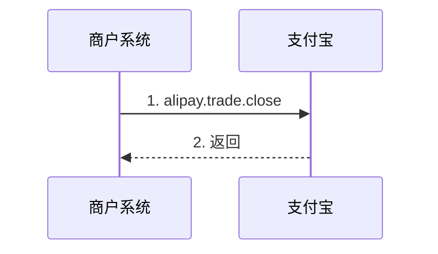
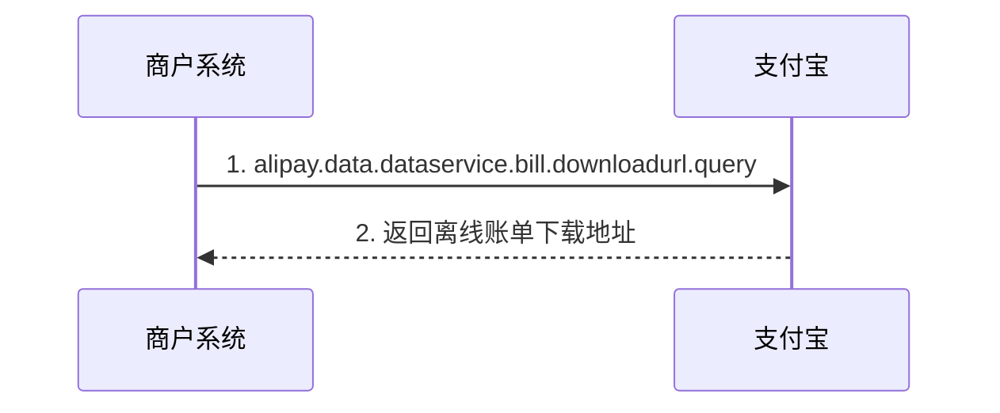

# 适用场景
适用于在商家网页应用中使用支付宝支付功能，支持个人收款场景。

::::aipay-tabs{defaultActiveKey="扫码支付"}
:::aipay-tab{key="扫码支付" title="扫码支付"}
<!-- 这是一张图片，ocr 内容为：1.选择支付宝支付 2.扫码付款 支付宝 我的收钱台 259.00元 订单提交成功,请尽快完成支付~订单号:3840776 259.00 28:33内支付,收货可返298积分 收费信息: 应付金额:298 支付宝 平台支付 3.手机APP端支付 4.支付成功 18:27 完成 支付成功 ￥ 298.00 中国移动 交易方式 金属环 298.00 本店转送 X 使用密码 20G特惠流量包 1元月 298.00 优惠限享一次,先到先得 384077676 订单信息 账户余额 确认付款 完成 本服务由支付宝(中国)网络技术有限公司提供 -->

:::

:::aipay-tab{key="登录支付" title="登录支付"}
<!-- 这是一张图片，ocr 内容为：1.选择支付宝支付 2.登录支付宝账户 支付宝 我的救战合 298.00元 订单洋铸 订单提交成功,请尽快完成支付~ 订单号:384077676 28:33内支付,收货可返298积分 登录支付宝账户付款 试试手机支付宝 账户名: 应付全额: 手机号码/咖啡 支付宝 平台支付 一打付款 下一步 4.支付成功 3.进行支付 支 支付宝 支付宝 我的收银台 我的收银台 找人代何   唯一湘如5188 298.00元 牧欺方 您已成功付款298.00元! 对方将立即收到您的付款. 如只您有未付款信息,查看并继续付款 您可能需要:查看余额消费记录我要充值 支付298.00元 账户余额 387元 为您推荐 添加笑陆/宽标约装 其他付款方式 水电煤缆瓷 信用卡还款 我要付款 足不出户   不 跨行还款 方便免费 跑行付钱轻松实现 支付宝正在检测作的安全设置.. 我要收款 通讯费 724小时通讯充值店 轻松收款 免开尊口 覆盖银行广到陈速度快 支付宝支付密码: 忘记富有? 收款主页  交房租 足不出户,房租照付 向多人收款,简单快捷 专国著名收款,收款更轻松 确认付款 -->

:::

::::

# Agent快速集成（推荐）
```markdown
通过 npx -y @alipay/alipay-aipay@latest install 安装支付宝 AI 付 Skill，加载 alipay-aipay 技能为我的项目集成网站支付，完成沙箱测试，并完成签约入驻
```


# 手动集成
## 系统流程


调用流程如下：

1. 商家系统调用 [alipay.trade.page.pay](/docs/vibe-pay/ai-web-app-payment-qianyi/api-list/alipay-trade-page-pay.html)（统一收单下单并支付页面接口）向支付宝发起支付请求，支付宝对商家请求参数进行校验，而后重新定向至用户登录页面。
2. 用户确认支付后，支付宝通过 get 请求 returnUrl（商户入参传入），返回同步返回参数。
3. 交易成功后，支付宝通过 post 请求 notifyUrl（商户入参传入），返回异步通知参数。
4. 若由于网络等原因，导致商家系统没有收到异步通知，商家可自行调用 [alipay.trade.query](/docs/vibe-pay/ai-web-app-payment-qianyi/api-list/alipay-trade-query.html)（统一收单交易查询接口）查询交易以及支付信息（商家也可以直接调用该查询接口，不需要依赖异步通知）。

**注意**： 

+ 由于同步返回的不可靠性，支付结果必须以异步通知或查询接口返回为准，不能依赖同步跳转。
+ 商家系统接收到异步通知以后，必须通过验签（验证通知中的 sign 参数）来确保支付通知是由支付宝发送的。详细验签规则可查看 [异步通知验签](/docs/vibe-pay/ai-web-app-payment-qianyi/api-list/async-notify-verify.html)。
+ 接收到异步通知并验签通过后，请务必核对通知中的 app_id、out_trade_no、total_amount 等参数值是否与请求中的一致，并根据 trade_status 进行后续业务处理。
+ 在支付宝端，partnerId 与 out_trade_no 唯一对应一笔单据，商家端保证不同次支付 out_trade_no 不可重复；若重复，支付宝会关联到原单据，基本信息一致的情况下会以原单据为准进行支付。

## 调用示例
开放平台提供了支持主流开发语言的 SDK 接入的方式。对于页面跳转类 API，SDK 不会也无法像系统调用类 API 一样自动请求支付宝并获得结果，而是在接受 request 请求对象后，为开发者生成前台页面请求需要的完整 form 表单的 html（包含自动提交脚本），商家直接将这个表单的 String 输出到 http response 中即可。  
**注意：**

+ 付款页面生成的付款码每 **2 分钟** 会自动刷新一次。

### 示例代码
以 Java 语言为例，调用 [alipay.trade.page.pay](/docs/vibe-pay/ai-web-app-payment-qianyi/api-list/alipay-trade-page-pay.html)（统一收单下单并支付页面接口） 的示例代码如下。

```java
package com.java.sdk.demo;

import com.alipay.api.AlipayApiException;
import com.alipay.api.AlipayClient;
import com.alipay.api.DefaultAlipayClient;
import com.alipay.api.AlipayConfig;
import com.alipay.api.domain.AlipayTradePagePayModel;
import com.alipay.api.domain.ExtUserInfo;
import com.alipay.api.domain.InvoiceKeyInfo;
import com.alipay.api.response.AlipayTradePagePayResponse;
import com.alipay.api.domain.InvoiceInfo;
import com.alipay.api.request.AlipayTradePagePayRequest;
import com.alipay.api.domain.ExtendParams;
import com.alipay.api.domain.GoodsDetail;
import com.alipay.api.domain.SubMerchant;

import com.alipay.api.FileItem;
import java.util.Base64;
import java.util.ArrayList;
import java.util.List;

public class AlipayTradePagePay {

    public static void main(String[] args) throws AlipayApiException {
        // 初始化SDK
        AlipayClient alipayClient = new DefaultAlipayClient(getAlipayConfig());

        // 构造请求参数以调用接口
        AlipayTradePagePayRequest request = new AlipayTradePagePayRequest();
        AlipayTradePagePayModel model = new AlipayTradePagePayModel();
        
        // 设置商户订单号
        model.setOutTradeNo("20150320010101001");
        
        // 设置订单总金额
        model.setTotalAmount("88.88");
        
        // 设置订单标题
        model.setSubject("Iphone6 16G");
        
        // 设置产品码
        model.setProductCode("FAST_INSTANT_TRADE_PAY");
        
        // 设置PC扫码支付的方式
        model.setQrPayMode("1");
        
        // 设置商户自定义二维码宽度
        model.setQrcodeWidth(100L);
        
        // 设置订单包含的商品列表信息
        List<GoodsDetail> goodsDetail = new ArrayList<GoodsDetail>();
        GoodsDetail goodsDetail0 = new GoodsDetail();
        goodsDetail0.setGoodsName("ipad");
        goodsDetail0.setAlipayGoodsId("20010001");
        goodsDetail0.setQuantity(1L);
        goodsDetail0.setPrice("2000");
        goodsDetail0.setGoodsId("apple-01");
        goodsDetail0.setGoodsCategory("34543238");
        goodsDetail0.setCategoriesTree("124868003|126232002|126252004");
        goodsDetail0.setShowUrl("http://www.alipay.com/xxx.jpg");
        goodsDetail.add(goodsDetail0);
        model.setGoodsDetail(goodsDetail);
        
        // 设置订单绝对超时时间
        model.setTimeExpire("2016-12-31 10:05:01");
        
        // 设置二级商户信息
        SubMerchant subMerchant = new SubMerchant();
        subMerchant.setMerchantId("2088000603999128");
        subMerchant.setMerchantType("alipay");
        model.setSubMerchant(subMerchant);
        
        // 设置业务扩展参数
        ExtendParams extendParams = new ExtendParams();
        extendParams.setSysServiceProviderId("2088511833207846");
        extendParams.setHbFqSellerPercent("100");
        extendParams.setHbFqNum("3");
        extendParams.setIndustryRefluxInfo("{\"scene_code\":\"metro_tradeorder\",\"channel\":\"xxxx\",\"scene_data\":{\"asset_name\":\"ALIPAY\"}}");
        extendParams.setRoyaltyFreeze("true");
        extendParams.setCardType("S0JP0000");
        model.setExtendParams(extendParams);
        
        // 设置商户传入业务信息
        model.setBusinessParams("{\"mc_create_trade_ip\":\"127.0.0.1\"}");
        
        // 设置优惠参数 
        model.setPromoParams("{\"storeIdType\":\"1\"}");
        
        // 设置请求后页面的集成方式
        model.setIntegrationType("PCWEB");
        
        // 设置请求来源地址
        model.setRequestFromUrl("https://");
        
        // 设置商户门店编号
        model.setStoreId("NJ_001");
        
        // 设置商户的原始订单号
        model.setMerchantOrderNo("20161008001");
        
        // 设置外部指定买家
        ExtUserInfo extUserInfo = new ExtUserInfo();
        extUserInfo.setCertType("IDENTITY_CARD");
        extUserInfo.setCertNo("362334768769238881");
        extUserInfo.setMobile("16587658765");
        extUserInfo.setName("李明");
        extUserInfo.setMinAge("18");
        extUserInfo.setNeedCheckInfo("F");
        extUserInfo.setIdentityHash("27bfcd1dee4f22c8fe8a2374af9b660419d1361b1c207e9b41a754a113f38fcc");
        model.setExtUserInfo(extUserInfo);
        
        // 设置开票信息
        InvoiceInfo invoiceInfo = new InvoiceInfo();
        InvoiceKeyInfo keyInfo = new InvoiceKeyInfo();
        keyInfo.setTaxNum("1464888883494");
        keyInfo.setIsSupportInvoice(true);
        keyInfo.setInvoiceMerchantName("ABC|003");
        invoiceInfo.setKeyInfo(keyInfo);
        invoiceInfo.setDetails("[{\"code\":\"100294400\",\"name\":\"服饰\",\"num\":\"2\",\"sumPrice\":\"200.00\",\"taxRate\":\"6%\"}]");
        model.setInvoiceInfo(invoiceInfo);
        
        request.setBizModel(model);
        // 第三方代调用模式下请设置app_auth_token
        // request.putOtherTextParam("app_auth_token", "<-- 请填写应用授权令牌 -->");

        AlipayTradePagePayResponse response = alipayClient.pageExecute(request, "POST");
        // 如果需要返回GET请求，请使用
        // AlipayTradePagePayResponse response = alipayClient.pageExecute(request, "GET");
        String pageRedirectionData = response.getBody();
        System.out.println(pageRedirectionData);

        if (response.isSuccess()) {
            System.out.println("调用成功");
        } else {
            System.out.println("调用失败");
            // sdk版本是"4.38.0.ALL"及以上,可以参考下面的示例获取诊断链接
            // String diagnosisUrl = DiagnosisUtils.getDiagnosisUrl(response);
            // System.out.println(diagnosisUrl);
        }
    }

    private static AlipayConfig getAlipayConfig() {
        String privateKey  = "<-- 请填写您的应用私钥，例如：MIIEvQIBADANB ... ... -->";
        String alipayPublicKey = "<-- 请填写您的支付宝公钥，例如：MIIBIjANBg... -->";
        AlipayConfig alipayConfig = new AlipayConfig();
        alipayConfig.setServerUrl("https://openapi.alipay.com/gateway.do");
        alipayConfig.setAppId("<-- 请填写您的AppId，例如：2019091767145019 -->");
        alipayConfig.setPrivateKey(privateKey);
        alipayConfig.setFormat("json");
        alipayConfig.setAlipayPublicKey(alipayPublicKey);
        alipayConfig.setCharset("UTF-8");
        alipayConfig.setSignType("RSA2");
        return alipayConfig;
    }
}
```

### 重要入参说明
**注意**：请严格按照接口文档中的参数入参，传入非接口文档中的参数是无效的，并且可能会导致请求被拦截或其它异常。

| **参数名称** | **参数说明** |
| --- | --- |
| subject | **必填**，商品的标题/交易标题/订单标题/订单关键字等。 不可使用特殊字符，如 /,=,& 等。 |
| product_code | **必填**，销售产品码，与支付宝签约的产品码名称。目前电脑支付场景下仅支持 `FAST_INSTANT_TRADE_PAY` |
| total_amount | **必填**，订单总金额，单位为元，精确到小数点后两位，取值范围为 [0.01,100000000]。金额不能为0。 |


对异步返回结果进行验签的 Java 示例代码如下：

```java
Map<String, String> paramsMap = ...  //将异步通知中收到的所有参数都存放到 map 中 
 boolean  signVerified = AlipaySignature.rsaCheckV1(paramsMap, ALIPAY_PUBLIC_KEY, CHARSET, SIGN_TYPE)  //调用SDK验证签名 
 if (signVerified){
     // TODO 验签成功后，按照支付结果异步通知中的描述，对支付结果中的业务内容进行二次校验，校验成功后在response中返回success并继续商家自身业务处理，校验失败返回failure 
} else {
     // TODO 验签失败则记录异常日志，并在response中返回failure. 
}
```

以 Java 语言为例，调用 [alipay.trade.query](/docs/vibe-pay/ai-web-app-payment-qianyi/api-list/alipay-trade-query.html)（统一收单交易查询接口）的示例代码如下：

```java
package com.java.sdk.demo;

import com.alipay.api.AlipayApiException;
import com.alipay.api.AlipayClient;
import com.alipay.api.DefaultAlipayClient;
import com.alipay.api.AlipayConfig;
import com.alipay.api.response.AlipayTradeQueryResponse;
import com.alipay.api.request.AlipayTradeQueryRequest;
import com.alipay.api.domain.AlipayTradeQueryModel;

import com.alipay.api.FileItem;
import java.util.Base64;
import java.util.ArrayList;
import java.util.List;

public class AlipayTradeQuery {

    public static void main(String[] args) throws AlipayApiException {
        // 初始化SDK
        AlipayClient alipayClient = new DefaultAlipayClient(getAlipayConfig());

        // 构造请求参数以调用接口
        AlipayTradeQueryRequest request = new AlipayTradeQueryRequest();
        AlipayTradeQueryModel model = new AlipayTradeQueryModel();
        
        // 设置订单支付时传入的商户订单号
        model.setOutTradeNo("20150320010101001");
        
        // 设置支付宝交易号
        model.setTradeNo("2014112611001004680 073956707");
        
        // 设置银行间联模式下有用
        model.setOrgPid("2088101117952222");
        
        // 设置查询选项
        List<String> queryOptions = new ArrayList<String>();
        queryOptions.add("trade_settle_info");
        model.setQueryOptions(queryOptions);
        
        request.setBizModel(model);
        // 第三方代调用模式下请设置app_auth_token
        // request.putOtherTextParam("app_auth_token", "<-- 请填写应用授权令牌 -->");

        AlipayTradeQueryResponse response = alipayClient.execute(request);
        System.out.println(response.getBody());

        if (response.isSuccess()) {
            System.out.println("调用成功");
        } else {
            System.out.println("调用失败");
            // sdk版本是"4.38.0.ALL"及以上,可以参考下面的示例获取诊断链接
            // String diagnosisUrl = DiagnosisUtils.getDiagnosisUrl(response);
            // System.out.println(diagnosisUrl);
        }
    }

    private static AlipayConfig getAlipayConfig() {
        String privateKey  = "<-- 请填写您的应用私钥，例如：MIIEvQIBADANB ... ... -->";
        String alipayPublicKey = "<-- 请填写您的支付宝公钥，例如：MIIBIjANBg... -->";
        AlipayConfig alipayConfig = new AlipayConfig();
        alipayConfig.setServerUrl("https://openapi.alipay.com/gateway.do");
        alipayConfig.setAppId("<-- 请填写您的AppId，例如：2019091767145019 -->");
        alipayConfig.setPrivateKey(privateKey);
        alipayConfig.setFormat("json");
        alipayConfig.setAlipayPublicKey(alipayPublicKey);
        alipayConfig.setCharset("UTF-8");
        alipayConfig.setSignType("RSA2");
        return alipayConfig;
    }
}
```

# 退款流程
当交易发生之后一段时间内，由于买家或者卖家的原因需要退款时，卖家可以通过退款接口将支付款退还给买家，支付宝将在收到退款请求并且验证成功之后，按照退款规则将支付款按原路退回到买家账号上。

## 系统流程
商家可调用 [alipay.trade.refund](/docs/vibe-pay/ai-web-app-payment-qianyi/api-list/alipay-trade-refund.html)（统一收单交易退款接口）进行退款，支付宝同步返回退款参数。调用时序图如下： 



+ 若退款接口由于网络等原因返回异常，商家可调用退款查询接口 [alipay.trade.fastpay.refund.query](/docs/vibe-pay/ai-web-app-payment-qianyi/api-list/alipay-trade-fastpay-refund-query.html)（统一收单交易退款查询接口）查询指定交易的退款信息。
+ 支付宝退款支持单笔交易分多次退款，多次退款需要提交原支付订单的商户订单号和设置不同的退款单号。

## 退款说明
+ **退款周期：** 12 个月，即交易发生后 12 个月内可发起退款，超过 12 个月则不可发起退款。
+ **退款方式：** 资金原路返回用户账号。
+ **退款退费：** 退款时手续费不退回。
+ 一笔退款失败后重新提交，要采用原来的退款单号。
+ 总退款金额不能超过用户实际支付金额。
+ 退款信息以退款接口同步返回或者 [alipay.trade.fastpay.refund.query](/docs/vibe-pay/ai-web-app-payment-qianyi/api-list/alipay-trade-fastpay-refund-query.html)（统一收单交易退款查询接口）为准。

## 调用示例
开放平台提供了支持主流开发语言的 SDK 接入的方式，以 Java 语言为例，调用 [alipay.trade.refund](/docs/vibe-pay/ai-web-app-payment-qianyi/api-list/alipay-trade-refund.html)（统一收单交易退款接口）的示例代码如下：

```java
package com.java.sdk.demo;

import com.alipay.api.AlipayApiException;
import com.alipay.api.AlipayClient;
import com.alipay.api.DefaultAlipayClient;
import com.alipay.api.AlipayConfig;
import com.alipay.api.domain.AlipayTradeRefundModel;
import com.alipay.api.request.AlipayTradeRefundRequest;
import com.alipay.api.response.AlipayTradeRefundResponse;
import com.alipay.api.domain.RefundGoodsDetail;
import com.alipay.api.domain.OpenApiRoyaltyDetailInfoPojo;

import com.alipay.api.FileItem;
import java.util.Base64;
import java.util.ArrayList;
import java.util.List;

public class AlipayTradeRefund {

    public static void main(String[] args) throws AlipayApiException {
        // 初始化SDK
        AlipayClient alipayClient = new DefaultAlipayClient(getAlipayConfig());

        // 构造请求参数以调用接口
        AlipayTradeRefundRequest request = new AlipayTradeRefundRequest();
        AlipayTradeRefundModel model = new AlipayTradeRefundModel();
        
        // 设置商户订单号
        model.setOutTradeNo("20150320010101001");
        
        // 设置支付宝交易号
        model.setTradeNo("2014112611001004680073956707");
        
        // 设置退款金额
        model.setRefundAmount("200.12");
        
        // 设置退款原因说明
        model.setRefundReason("正常退款");
        
        // 设置退款请求号
        model.setOutRequestNo("HZ01RF001");
        
        // 设置退款包含的商品列表信息
        List<RefundGoodsDetail> refundGoodsDetail = new ArrayList<RefundGoodsDetail>();
        RefundGoodsDetail refundGoodsDetail0 = new RefundGoodsDetail();
        refundGoodsDetail0.setOutSkuId("outSku_01");
        refundGoodsDetail0.setOutItemId("outItem_01");
        refundGoodsDetail0.setGoodsId("apple-01");
        refundGoodsDetail0.setRefundAmount("19.50");
        List<String> outCertificateNoList = new ArrayList<String>();
        outCertificateNoList.add("202407013232143241231243243423");
        refundGoodsDetail0.setOutCertificateNoList(outCertificateNoList);
        refundGoodsDetail.add(refundGoodsDetail0);
        model.setRefundGoodsDetail(refundGoodsDetail);
        
        // 设置退分账明细信息
        List<OpenApiRoyaltyDetailInfoPojo> refundRoyaltyParameters = new ArrayList<OpenApiRoyaltyDetailInfoPojo>();
        OpenApiRoyaltyDetailInfoPojo refundRoyaltyParameters0 = new OpenApiRoyaltyDetailInfoPojo();
        refundRoyaltyParameters0.setAmount("0.1");
        refundRoyaltyParameters0.setTransIn("2088101126708402");
        refundRoyaltyParameters0.setRoyaltyType("transfer");
        refundRoyaltyParameters0.setTransOut("2088101126765726");
        refundRoyaltyParameters0.setTransOutType("userId");
        refundRoyaltyParameters0.setRoyaltyScene("达人佣金");
        refundRoyaltyParameters0.setTransInType("userId");
        refundRoyaltyParameters0.setTransInName("张三");
        refundRoyaltyParameters0.setDesc("分账给2088101126708402");
        refundRoyaltyParameters.add(refundRoyaltyParameters0);
        model.setRefundRoyaltyParameters(refundRoyaltyParameters);
        
        // 设置查询选项
        List<String> queryOptions = new ArrayList<String>();
        queryOptions.add("refund_detail_item_list");
        model.setQueryOptions(queryOptions);
        
        // 设置针对账期交易
        model.setRelatedSettleConfirmNo("2024041122001495000530302869");
        
        request.setBizModel(model);
        // 第三方代调用模式下请设置app_auth_token
        // request.putOtherTextParam("app_auth_token", "<-- 请填写应用授权令牌 -->");

        AlipayTradeRefundResponse response = alipayClient.execute(request);
        System.out.println(response.getBody());

        if (response.isSuccess()) {
            System.out.println("调用成功");
        } else {
            System.out.println("调用失败");
            // sdk版本是"4.38.0.ALL"及以上,可以参考下面的示例获取诊断链接
            // String diagnosisUrl = DiagnosisUtils.getDiagnosisUrl(response);
            // System.out.println(diagnosisUrl);
        }
    }

    private static AlipayConfig getAlipayConfig() {
        String privateKey  = "<-- 请填写您的应用私钥，例如：MIIEvQIBADANB ... ... -->";
        String alipayPublicKey = "<-- 请填写您的支付宝公钥，例如：MIIBIjANBg... -->";
        AlipayConfig alipayConfig = new AlipayConfig();
        alipayConfig.setServerUrl("https://openapi.alipay.com/gateway.do");
        alipayConfig.setAppId("<-- 请填写您的AppId，例如：2019091767145019 -->");
        alipayConfig.setPrivateKey(privateKey);
        alipayConfig.setFormat("json");
        alipayConfig.setAlipayPublicKey(alipayPublicKey);
        alipayConfig.setCharset("UTF-8");
        alipayConfig.setSignType("RSA2");
        return alipayConfig;
    }
}
```

  
调用 [alipay.trade.fastpay.refund.query](/docs/vibe-pay/ai-web-app-payment-qianyi/api-list/alipay-trade-fastpay-refund-query.html)（统一收单交易退款查询接口）Java 示例代码如下：

```java
package com.java.sdk.demo;

import com.alipay.api.AlipayApiException;
import com.alipay.api.AlipayClient;
import com.alipay.api.DefaultAlipayClient;
import com.alipay.api.AlipayConfig;
import com.alipay.api.domain.AlipayTradeFastpayRefundQueryModel;
import com.alipay.api.response.AlipayTradeFastpayRefundQueryResponse;
import com.alipay.api.request.AlipayTradeFastpayRefundQueryRequest;

import com.alipay.api.FileItem;
import java.util.Base64;
import java.util.ArrayList;
import java.util.List;

public class AlipayTradeFastpayRefundQuery {

    public static void main(String[] args) throws AlipayApiException {
        // 初始化SDK
        AlipayClient alipayClient = new DefaultAlipayClient(getAlipayConfig());

        // 构造请求参数以调用接口
        AlipayTradeFastpayRefundQueryRequest request = new AlipayTradeFastpayRefundQueryRequest();
        AlipayTradeFastpayRefundQueryModel model = new AlipayTradeFastpayRefundQueryModel();
        
        // 设置支付宝交易号
        model.setTradeNo("2021081722001419121412730660");
        
        // 设置商户订单号
        model.setOutTradeNo("2014112611001004680073956707");
        
        // 设置退款请求号
        model.setOutRequestNo("HZ01RF001");
        
        // 设置查询选项
        List<String> queryOptions = new ArrayList<String>();
        queryOptions.add("refund_detail_item_list");
        model.setQueryOptions(queryOptions);
        
        request.setBizModel(model);
        // 第三方代调用模式下请设置app_auth_token
        // request.putOtherTextParam("app_auth_token", "<-- 请填写应用授权令牌 -->");

        AlipayTradeFastpayRefundQueryResponse response = alipayClient.execute(request);
        System.out.println(response.getBody());

        if (response.isSuccess()) {
            System.out.println("调用成功");
        } else {
            System.out.println("调用失败");
            // sdk版本是"4.38.0.ALL"及以上,可以参考下面的示例获取诊断链接
            // String diagnosisUrl = DiagnosisUtils.getDiagnosisUrl(response);
            // System.out.println(diagnosisUrl);
        }
    }

    private static AlipayConfig getAlipayConfig() {
        String privateKey  = "<-- 请填写您的应用私钥，例如：MIIEvQIBADANB ... ... -->";
        String alipayPublicKey = "<-- 请填写您的支付宝公钥，例如：MIIBIjANBg... -->";
        AlipayConfig alipayConfig = new AlipayConfig();
        alipayConfig.setServerUrl("https://openapi.alipay.com/gateway.do");
        alipayConfig.setAppId("<-- 请填写您的AppId，例如：2019091767145019 -->");
        alipayConfig.setPrivateKey(privateKey);
        alipayConfig.setFormat("json");
        alipayConfig.setAlipayPublicKey(alipayPublicKey);
        alipayConfig.setCharset("UTF-8");
        alipayConfig.setSignType("RSA2");
        return alipayConfig;
    }
}
```

# 关闭交易
通常交易关闭是通过 alipay.trade.page.pay 中的超时时间来控制，支付宝也提供给商家 [alipay.trade.close](/docs/vibe-pay/ai-web-app-payment-qianyi/api-list/alipay-trade-close.html)（统一收单交易关闭接口）。若用户一直未支付，商家可以调用该接口关闭指定交易；成功关闭交易后该交易不可支付。

## 系统流程
交易关闭接口的调用时序图 [alipay.trade.close](/docs/vibe-pay/ai-web-app-payment-qianyi/api-list/alipay-trade-close.html)（统一收单交易关闭接口）如下图所示：



## 调用示例
开放平台提供了支持主流开发语言的 SDK 接入的方式，以 Java 语言为例，调用 [alipay.trade.close](/docs/vibe-pay/ai-web-app-payment-qianyi/api-list/alipay-trade-close.html)（统一收单交易关闭接口）的示例代码如下：

```java
package com.java.sdk.demo;

import com.alipay.api.AlipayApiException;
import com.alipay.api.AlipayClient;
import com.alipay.api.DefaultAlipayClient;
import com.alipay.api.AlipayConfig;
import com.alipay.api.request.AlipayTradeCloseRequest;
import com.alipay.api.domain.AlipayTradeCloseModel;
import com.alipay.api.response.AlipayTradeCloseResponse;

import com.alipay.api.FileItem;
import java.util.Base64;
import java.util.ArrayList;
import java.util.List;

public class AlipayTradeClose {

    public static void main(String[] args) throws AlipayApiException {
        // 初始化SDK
        AlipayClient alipayClient = new DefaultAlipayClient(getAlipayConfig());

        // 构造请求参数以调用接口
        AlipayTradeCloseRequest request = new AlipayTradeCloseRequest();
        AlipayTradeCloseModel model = new AlipayTradeCloseModel();
        
        // 设置该交易在支付宝系统中的交易流水号
        model.setTradeNo("2013112611001004680073956707");
        
        // 设置订单支付时传入的商户订单号
        model.setOutTradeNo("HZ0120131127001");
        
        // 设置商家操作员编号 id
        model.setOperatorId("YX01");
        
        request.setBizModel(model);
        // 第三方代调用模式下请设置app_auth_token
        // request.putOtherTextParam("app_auth_token", "<-- 请填写应用授权令牌 -->");

        AlipayTradeCloseResponse response = alipayClient.execute(request);
        System.out.println(response.getBody());

        if (response.isSuccess()) {
            System.out.println("调用成功");
        } else {
            System.out.println("调用失败");
            // sdk版本是"4.38.0.ALL"及以上,可以参考下面的示例获取诊断链接
            // String diagnosisUrl = DiagnosisUtils.getDiagnosisUrl(response);
            // System.out.println(diagnosisUrl);
        }
    }

    private static AlipayConfig getAlipayConfig() {
        String privateKey  = "<-- 请填写您的应用私钥，例如：MIIEvQIBADANB ... ... -->";
        String alipayPublicKey = "<-- 请填写您的支付宝公钥，例如：MIIBIjANBg... -->";
        AlipayConfig alipayConfig = new AlipayConfig();
        alipayConfig.setServerUrl("https://openapi.alipay.com/gateway.do");
        alipayConfig.setAppId("<-- 请填写您的AppId，例如：2019091767145019 -->");
        alipayConfig.setPrivateKey(privateKey);
        alipayConfig.setFormat("json");
        alipayConfig.setAlipayPublicKey(alipayPublicKey);
        alipayConfig.setCharset("UTF-8");
        alipayConfig.setSignType("RSA2");
        return alipayConfig;
    }
}
```

# 对账流程
为方便商家快速查账，开放平台支持商家通过 [alipay.data.dataservice.bill.downloadurl.query](/docs/vibe-pay/ai-web-app-payment-qianyi/api-list/alipay-data-dataservice-bill-downloadurl-query.html)（查询对账单下载地址接口）获取商家离线账单下载地址。

## 调用流程
调用该接口的时序图如下：



## 调用示例
开放平台提供了支持主流开发语言的 SDK 接入的方式，以 Java 语言为例，调用 [alipay.data.dataservice.bill.downloadurl.query](/docs/vibe-pay/ai-web-app-payment-qianyi/api-list/alipay-data-dataservice-bill-downloadurl-query.html)（查询对账单下载地址接口）的示例代码如下：

```java
package com.java.sdk.demo;

import com.alipay.api.AlipayApiException;
import com.alipay.api.AlipayClient;
import com.alipay.api.DefaultAlipayClient;
import com.alipay.api.AlipayConfig;
import com.alipay.api.request.AlipayDataDataserviceBillDownloadurlQueryRequest;
import com.alipay.api.response.AlipayDataDataserviceBillDownloadurlQueryResponse;
import com.alipay.api.domain.AlipayDataDataserviceBillDownloadurlQueryModel;

import com.alipay.api.FileItem;
import java.util.Base64;
import java.util.ArrayList;
import java.util.List;

public class AlipayDataDataserviceBillDownloadurlQuery {

    public static void main(String[] args) throws AlipayApiException {
        // 初始化SDK
        AlipayClient alipayClient = new DefaultAlipayClient(getAlipayConfig());

        // 构造请求参数以调用接口
        AlipayDataDataserviceBillDownloadurlQueryRequest request = new AlipayDataDataserviceBillDownloadurlQueryRequest();
        AlipayDataDataserviceBillDownloadurlQueryModel model = new AlipayDataDataserviceBillDownloadurlQueryModel();
        
        // 设置账单类型
        model.setBillType("trade");
        
        // 设置账单时间
        model.setBillDate("2025-05-01");
        
        // 设置二级商户smid
        model.setSmid("2088123412341234");
        
        request.setBizModel(model);
        // 第三方代调用模式下请设置app_auth_token
        // request.putOtherTextParam("app_auth_token", "<-- 请填写应用授权令牌 -->");

        AlipayDataDataserviceBillDownloadurlQueryResponse response = alipayClient.execute(request);
        System.out.println(response.getBody());

        if (response.isSuccess()) {
            System.out.println("调用成功");
        } else {
            System.out.println("调用失败");
            // sdk版本是"4.38.0.ALL"及以上,可以参考下面的示例获取诊断链接
            // String diagnosisUrl = DiagnosisUtils.getDiagnosisUrl(response);
            // System.out.println(diagnosisUrl);
        }
    }

    private static AlipayConfig getAlipayConfig() {
        String privateKey  = "<-- 请填写您的应用私钥，例如：MIIEvQIBADANB ... ... -->";
        String alipayPublicKey = "<-- 请填写您的支付宝公钥，例如：MIIBIjANBg... -->";
        AlipayConfig alipayConfig = new AlipayConfig();
        alipayConfig.setServerUrl("https://openapi.alipay.com/gateway.do");
        alipayConfig.setAppId("<-- 请填写您的AppId，例如：2019091767145019 -->");
        alipayConfig.setPrivateKey(privateKey);
        alipayConfig.setFormat("json");
        alipayConfig.setAlipayPublicKey(alipayPublicKey);
        alipayConfig.setCharset("UTF-8");
        alipayConfig.setSignType("RSA2");
        return alipayConfig;
    }
}
```

开发者在得到接口返回的账单下载地址（bill_download_url）后还可以下载账单文件，Java 示例代码如下：

```java
//将接口返回的对账单下载地址传入urlStr 
String urlStr =  "下载地址" ;
 //指定希望保存的文件路径 
String filePath =  "/Users/fund_bill_20210205.csv" ;
URL url =  null ;
HttpURLConnection httpUrlConnection =  null ;
InputStream fis =  null ;
FileOutputStream fos =  null ;
 try  {
    url =  new  URL(urlStr);
    httpUrlConnection = (HttpURLConnection) url.openConnection();
    httpUrlConnection.setConnectTimeout( 5  *  1000 );
    httpUrlConnection.setDoInput( true );
    httpUrlConnection.setDoOutput( true );
    httpUrlConnection.setUseCaches( false );
    httpUrlConnection.setRequestMethod( "GET" );
    httpUrlConnection.setRequestProperty( "Charsert" ,  "UTF-8" );
    httpUrlConnection.connect();
    fis = httpUrlConnection.getInputStream();
     byte [] temp =  new   byte [ 1024 ];
     int  b;
    fos =  new  FileOutputStream( new  File(filePath));
     while  ((b = fis.read(temp)) != - 1 ) {
        fos.write(temp,  0 , b);
        fos.flush();
    }
}  catch  (MalformedURLException e) {
    e.printStackTrace();
}  catch  (IOException e) {
    e.printStackTrace();
}  finally  {
     try  {
         if (fis!= null ) fis.close();
         if (fos!= null ) fos.close();
         if (httpUrlConnection!= null ) httpUrlConnection.disconnect();
    }  catch  (IOException e) {
        e.printStackTrace();
    }
```
